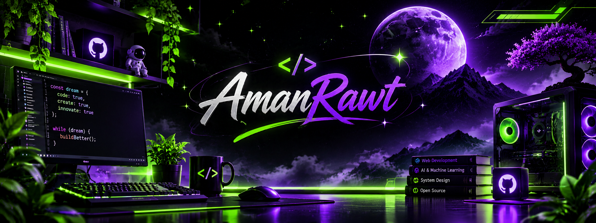

 

 

#  AMAN RAWAT

### Building ideas into digital experiences.

*Learning by building. Creating with purpose.*

---

## ◈ About Me

Hey! I'm **Aman Rawat**, a developer who enjoys exploring technology and turning ideas into useful digital products.

- Building and experimenting with projects.
- Exploring web development and AI-powered products.
- Interested in creative problem solving.
- Building under **Farop Studio**.

---

## ◈ Featured Project

### ✧ ReadyCV

An AI-powered resume builder and ATS resume analyzer designed to help people create professional, job-ready resumes.

---

## ◈ Tech & Tools

  

---

## ◈ Let's Connect

[GitHub](https://github.com/AmanRawt) &nbsp; • &nbsp; [LinkedIn](https://www.linkedin.com/in/amansinghrawat0204/) &nbsp; • &nbsp; [Google Play](https://play.google.com/store/apps/dev?id=6185794511768345124)

 

**FAROP STUDIO**

Crafting ideas. Building possibilities.

